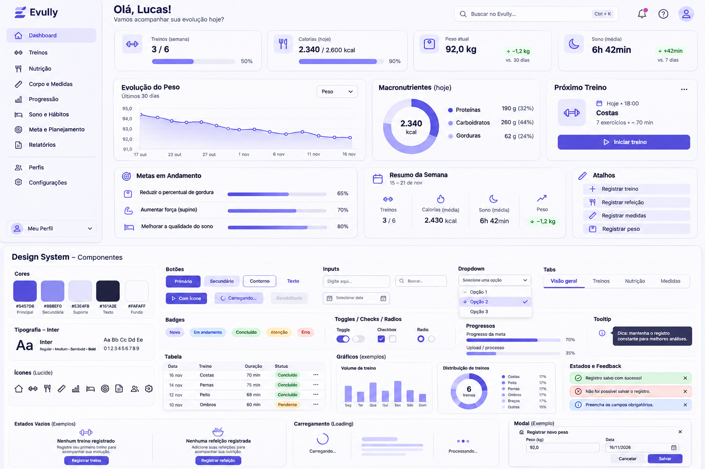
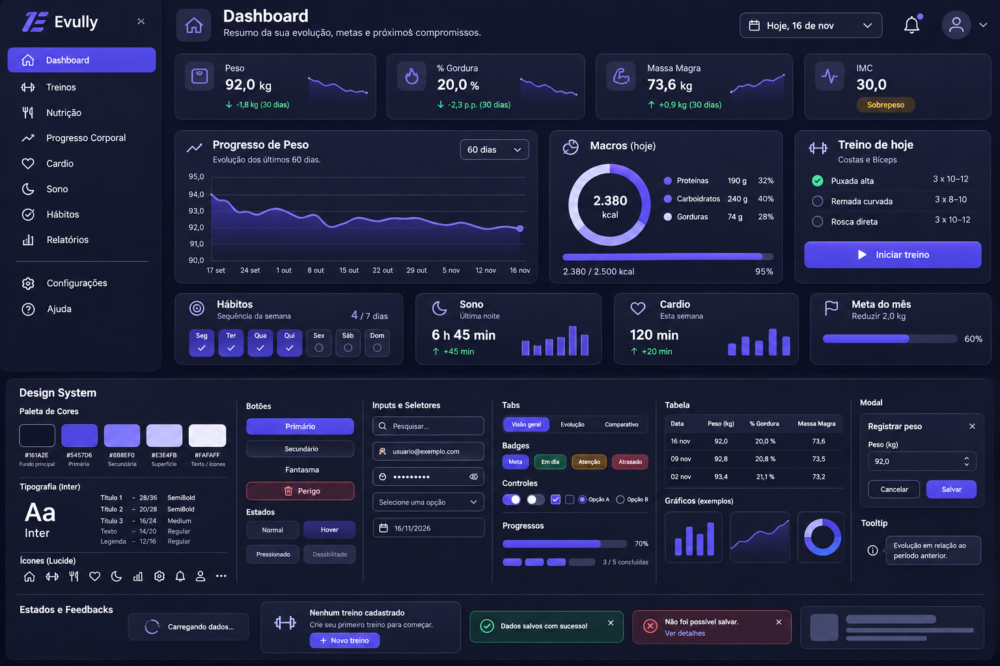

# EVULLY — Visual Identity & UI/UX Implementation Specification

**Documento:** `DESIGN_IMPLEMENTATION.md`\
**Produto:** Evully\
**Versão da especificação:** 1.0\
**Status:** Diretriz aprovada para implementação visual (V1.1, README §15.3)\
**Idioma da interface:** Português brasileiro (`pt-BR`)\
**Repositório:** https://github.com/lbcamargo94/EvullyApp

---

## 1. Objetivo deste documento

Este documento transforma as duas propostas visuais aprovadas para o
Evully (Light Mode e Dark Mode) em uma especificação de implementação
para agentes de programação e desenvolvedores.

A IA de código deve usar este documento em conjunto com os arquivos
oficiais do repositório, especialmente:

- `README.md`: especificação do produto, funcionalidades, roadmap e
  regras de negócio.
- `DESIGN.md`: fonte oficial da identidade visual, tokens,
  acessibilidade e componentes.
- `FRONTEND.md`: arquitetura e divisão das interfaces por plataforma.
- `ARCHITECTURE.md`: limites entre renderer, aplicação, domínio e
  adaptadores.
- `CLAUDE.md` e instruções locais de agentes: fluxo de trabalho e
  regras específicas de desenvolvimento.

**Hierarquia de autoridade:** regras de produto, segurança e arquitetura
existentes no repositório prevalecem sobre qualquer detalhe meramente
ilustrativo das imagens de referência. Este documento complementa e
detalha o design; não autoriza reescrever a arquitetura nem alterar
regras de negócio.

## 2. Resultado visual esperado

O Evully deve ter aparência de um produto comercial maduro de saúde,
fitness e acompanhamento pessoal: moderno, premium, organizado,
acolhedor e orientado a dados.

As duas referências visuais aprovadas representam a mesma identidade em
dois temas:

1. **Light Mode:** aparência clara, leve, limpa e confortável, com
   superfícies suaves, bordas discretas e índigo como cor de ação.
2. **Dark Mode:** aparência escura, sofisticada e confortável para uso
   noturno, mantendo hierarquia, legibilidade e os mesmos padrões de
   componentes.

Os temas devem ser equivalentes em funcionalidade e hierarquia. Não
criar uma interface diferente para cada tema.

### 2.1 Princípios visuais obrigatórios

- Minimalismo funcional: cada elemento deve ter propósito.
- Hierarquia clara entre título, descrição, métricas, gráficos e ações.
- Números e métricas importantes devem ser fáceis de localizar e ler.
- Cards organizados em grupos coerentes, sem excesso de contornos ou
  sombras.
- Espaçamento consistente, usando a escala de 4 px.
- Ícones Lucide com traço consistente.
- Microinterações discretas e rápidas.
- Tom humano, neutro e encorajador; nunca punitivo ou constrangedor.
- A interface deve funcionar bem em janelas desktop de diferentes
  dimensões.
- Não usar aparência de template genérico de dashboard administrativo.

### 2.2 O que as imagens de referência significam

As imagens geradas e aprovadas são referências de composição, densidade,
hierarquia e direção estética. Elas **não** são especificações de dados,
valores, funcionalidades ou regras de negócio.

Não copiar como dados reais os números de peso, calorias, macros, sono,
percentuais, metas ou nomes de exercícios exibidos nas imagens. Usar
dados reais vindos dos casos de uso e view models. Em catálogo visual e
testes, usar fixtures claramente fictícias.

## 3. Regras de compatibilidade com o projeto atual

Antes de alterar qualquer arquivo, a IA deve inspecionar a estrutura
atual do repositório e identificar o que já existe. Não presumir que a
estrutura descrita neste documento está implementada integralmente.

### 3.1 Stack e arquitetura a preservar

Respeitar as decisões documentadas no projeto, incluindo:

- Electron para o shell desktop.
- React + TypeScript na interface.
- Tailwind CSS 4 e shadcn/ui sobre Radix.
- Lucide para ícones.
- Recharts para gráficos.
- React Router com `HashRouter` no Electron.
- TanStack Query para estado de servidor/dados.
- `react-hook-form` + Zod para formulários.
- Monorepo npm workspaces.
- `packages/tokens` como fonte única de tokens.
- `packages/ui` para componentes visuais reutilizáveis.
- `packages/app-core` para lógica de tela sem dependência visual.
- `packages/app-web` para telas compartilhadas pelo desktop e futuro
  web.
- `apps/desktop` como shell Electron.

Não introduzir outra biblioteca de componentes, sistema de ícones,
solução de gráficos ou sistema de temas sem justificativa técnica e
aprovação explícita.

### 3.2 Limites arquiteturais

- Não colocar regra de negócio em componentes React.
- Não acessar SQLite, filesystem ou APIs Node diretamente no renderer.
- Não importar Electron em `packages/ui`, `packages/app-web` ou
  `packages/app-core`.
- Não mover telas para `apps/desktop` se a arquitetura determina que
  pertencem a `packages/app-web`.
- Não duplicar tokens nem definir paletas locais em componentes.
- Componentes compartilhados devem receber dados e callbacks por props.
- Manter o funcionamento offline/local-first e os perfis independentes.

## 4. Identidade visual e design tokens

`DESIGN.md` e `packages/tokens/tokens.json` são as fontes oficiais. A IA
deve primeiro verificar os valores reais existentes e preservá-los,
salvo se uma alteração for aprovada e documentada.

### 4.1 Paleta semântica oficial

Os valores abaixo são os documentados atualmente em `DESIGN.md` e devem
ser confirmados no código antes de qualquer alteração.

| Token | Light Mode | Dark Mode | Uso |
|---|---|---|---|
| `background` | `#EFEFFC` | `#0A0A0A` | Fundo geral |
| `surface` | `#FAFAFF` | `#171717` | Cards e painéis |
| `surface-muted` | `#E8E8FA` | `#262626` | Superfícies secundárias e item ativo |
| `border` | `#DCDDF2` | `#2A2A2A` | Bordas e divisórias |
| `text` | `#161A2E` | `#FAFAFA` | Texto principal |
| `text-muted` | `#5B6280` | `#A1A1A1` | Texto secundário |
| `brand` | `#5457D6` | `#8B8EF0` | Ações e destaques |
| `brand-foreground` | `#FFFFFF` | `#0A0A0A` | Texto sobre brand |
| `brand-soft` | `#E3E4FB` | `#262626` | Destaque suave |
| `brand-soft-foreground` | `#3F42B8` | `#FAFAFA` | Texto sobre destaque suave |
| `positive` | `#197648` | `#4CC38A` | Variação favorável |
| `caution` | `#975900` | `#F0B54A` | Variação contrária |
| `neutral` | `#606682` | `#A1A1A1` | Estável ou neutro |
| `danger` | `#B63D37` | `#F07A74` | Ações destrutivas e erros de sistema |
| `focus-ring` | `brand` | `brand` | Foco acessível |

**Importante:** não substituir automaticamente a paleta escura neutra
documentada por azul-marinho ou roxo azulado visto em uma imagem. A
referência pode inspirar a composição e a sensação visual, mas os tokens
oficiais continuam sendo a fonte de verdade.

### 4.2 Regras semânticas de cor

- `positive`, `caution` e `neutral` indicam a direção contextual de um
  indicador, não decoração.
- Nunca comunicar estado somente por cor: incluir texto, ícone ou sinal.
- `danger` é reservado a ações destrutivas e erros de sistema.
- Não usar vermelho para indicar aumento de peso ou qualquer variação
  corporal sem considerar o objetivo e a regra de direção do domínio.
- Não criar cores hardcoded, classes arbitrárias de cor ou valores
  hexadecimais dentro de telas.
- Todo novo par de texto/fundo deve passar pelo teste de contraste do
  projeto.

### 4.3 Tipografia

Usar Inter, embutida no aplicativo, conforme o projeto.

| Token | Tamanho / line-height | Peso | Aplicação |
|---|---|---|---|
| `display` | 36 / 44 px | 600 | Métrica principal |
| `title` | 24 / 32 px | 600 | Título de tela |
| `heading` | 18 / 26 px | 600 | Seções e cards |
| `body` | 15 / 22 px | 400 | Texto padrão |
| `caption` | 13 / 18 px | 400 | Rótulos e apoio |

- Métricas e tabelas devem usar `font-variant-numeric: tabular-nums`.
- Formatar datas e números com `Intl` e locale `pt-BR`.
- Evitar textos longos dentro de cards.
- Não reduzir a fonte para acomodar layouts apertados; reorganizar o
  layout.

### 4.4 Espaçamento, bordas e elevação

- Usar múltiplos de 4 px.
- Raios oficiais: `sm` 6 px para campos, `md` 10 px para botões, `lg`
  16 px para cards.
- Usar bordas discretas e sombras suaves no tema claro.
- No tema escuro, criar elevação principalmente pela diferença de
  superfície, não por sombras fortes.
- Não aplicar blur, glassmorphism, neon ou gradientes decorativos como
  padrão.
- Transições de até 200 ms e respeito a `prefers-reduced-motion`.

## 5. Layout global do aplicativo desktop

### 5.1 Estrutura

A composição desktop deve seguir a referência aprovada:

1. Barra lateral persistente à esquerda.
2. Área principal à direita.
3. Cabeçalho superior dentro da área principal.
4. Conteúdo organizado em seções e grids responsivos.
5. Cards com alinhamento, alturas e espaçamentos consistentes.

A navegação desktop deve preservar os requisitos atuais do `DESIGN.md`:
a partir de 1024 px, sidebar fixa e barra superior com o perfil atual. O
conteúdo deve respeitar a largura máxima documentada de 1200 px, sem
desperdiçar espaço em janelas largas.

### 5.2 Sidebar

Itens de navegação devem refletir as rotas e funcionalidades realmente
existentes. A lista visual pode incluir:

- Dashboard
- Treinos
- Nutrição
- Corpo e Medidas
- Progresso
- Cardio
- Sono e Hábitos
- Relatórios
- Perfis
- Configurações

A IA deve conferir as rotas existentes antes de criar ou renomear itens.
Não criar páginas sem funcionalidade só para preencher o menu.

Estados obrigatórios do item de navegação:

- Padrão.
- Hover.
- Foco por teclado.
- Ativo.
- Desabilitado, quando aplicável.

O item ativo deve usar `brand-soft` e `brand-soft-foreground` ou os
tokens equivalentes existentes. Ícone e texto devem permanecer legíveis
nos dois temas.

### 5.3 Cabeçalho

O cabeçalho deve suportar, conforme as capacidades existentes:

- Título da tela.
- Descrição curta opcional.
- Busca global, somente se já implementada ou prevista.
- Seletor de perfil atual.
- Ações contextuais.
- Preferência de tema, quando aplicável.

Não inventar notificações, busca global ou menus sem fluxo funcional
correspondente.

### 5.4 Responsividade

Preservar as regras do `DESIGN.md`:

- Desktop ≥ 1024 px: sidebar fixa.
- Tablet 768–1023 px: sidebar recolhida em ícones.
- Mobile < 768 px: navegação inferior e cabeçalho compacto, em
  fases/plataformas que suportem mobile.
- Alvos de toque no mínimo 44 × 44 px em interfaces touch.
- Componentes devem reflow sem sobreposição, corte de conteúdo ou
  scroll horizontal indevido.

## 6. Dashboard

O Dashboard deve priorizar uma leitura rápida da evolução e dos próximos
registros. A referência visual mostra uma composição em cards, mas o
conteúdo exibido deve depender da configuração de acompanhamento e dos
dados disponíveis para o perfil ativo.

### 6.1 Hierarquia recomendada

1. Saudação ou título e contexto do período.
2. Resumo dos principais indicadores.
3. Gráfico principal de evolução.
4. Resumo nutricional, quando houver dados.
5. Próximo treino ou atividade relevante, quando houver.
6. Metas/projetos em andamento.
7. Resumo semanal de hábitos, sono ou cardio, quando aplicável.
8. Atalhos para registros frequentes.

Não exibir cards vazios como se houvesse dados. Usar `EmptyState`,
estados de dados insuficientes ou ocultar módulos opcionais conforme as
regras do produto.

### 6.2 Cards de estatísticas

Usar o componente `StatCard` existente ou implementá-lo de forma
compatível.

Cada card pode conter:

- Rótulo curto.
- Valor principal e unidade.
- Variação em relação a um período definido, quando disponível.
- Indicador textual e ícone de tendência.
- Estado de dados insuficientes.
- Ação de navegação opcional.

Não assumir que "subir" é bom ou ruim. A direção deve vir do
contexto/objetivo calculado pelo domínio ou view model.

### 6.3 Gráficos

Usar Recharts e tokens semânticos.

- Linhas e barras simples, sem efeitos que prejudiquem leitura.
- Grade discreta.
- Eixos e tooltips formatados em `pt-BR`.
- Legenda quando houver mais de uma série.
- Tooltip com data e valor.
- Descrição textual acessível com resumo das séries.
- `role="img"` e descrição equivalente.
- Estados sem dados, carregando e erro.
- Cores extraídas dos tokens do tema atual.

Respeitar as regras de `DESIGN.md`: peso do dia como pontos discretos e
média de 7 dias como linha de destaque, quando esse gráfico for
utilizado. Não introduzir gradientes.

## 7. Telas e módulos

A IA deve implementar ou refinar cada tela com base nas funcionalidades
já existentes no `README.md`, sem inventar fluxos ou persistência.

### 7.1 Treinos

- Visão de planos e rotinas.
- Lista de exercícios e grupos.
- Detalhes de séries, repetições, carga e descanso.
- Execução de treino e marcação de séries concluídas, quando suportado.
- Histórico e evolução.
- Formulários claros para criar e editar.
- Estados vazios e confirmação inline.

### 7.2 Nutrição

- Resumo diário de calorias e macronutrientes, quando os dados
  existirem.
- Refeições e alimentos.
- Metas nutricionais vigentes.
- Indicadores de consumo e progresso.
- Unidades e valores sempre formatados em `pt-BR`.
- Não inventar valores nutricionais ou estimativas no frontend.

### 7.3 Corpo e Medidas

- Registro de peso.
- Registro de medidas corporais.
- Histórico por data.
- Campos com unidade explícita.
- Dicas de medição acessíveis por `aria-describedby`.
- Gráficos e comparações somente quando houver dados suficientes.
- Não classificar resultados com julgamento moral.

### 7.4 Progresso e relatórios

- Comparações por períodos suportados.
- Tendências e evolução.
- Indicadores contextualizados pelo objetivo do perfil.
- Tabelas legíveis e exportáveis, se já houver suporte.
- Não criar métricas calculadas no componente visual.

### 7.5 Cardio, sono e hábitos

- Registro simples e rápido.
- Histórico por dia/semana.
- Progresso com rótulos claros.
- Controles de conclusão com resposta visual imediata.
- Em gravação automática, reverter o controle se a persistência falhar,
  conforme o padrão existente.

### 7.6 Perfis e configurações

- Separação visual inequívoca do perfil ativo.
- Nunca misturar dados de perfis.
- Preferência de tema: Sistema, Claro ou Escuro, respeitando o
  comportamento já definido.
- Configurações devem refletir opções reais da aplicação.

## 8. Catálogo do Design System

Manter ou implementar o catálogo interno de componentes já previsto no
`DESIGN.md`, disponível somente em desenvolvimento. Não adicionar
Storybook sem aprovação: o projeto prevê uma página interna de catálogo.

O catálogo deve permitir alternar entre Light e Dark e apresentar
componentes em estados relevantes.

### 8.1 Tokens e identidade

- Amostras de cores semânticas.
- Tipografia e hierarquia.
- Escala de espaçamento.
- Raios e bordas.
- Elevação/sombras.
- Ícones Lucide.
- Exemplos de foco e contraste.

### 8.2 Componentes base

Verificar o que já existe em `packages/ui` antes de criar novos.

- Button: primário, secundário, contorno, texto, destrutivo, com ícone,
  loading e disabled.
- Input: texto, número, busca e senha, quando necessário.
- Select / Dropdown.
- Checkbox, Radio e Switch.
- Tabs.
- Badge / Status.
- Tooltip.
- Dialog / Modal.
- Table.
- Progress.
- Alert / Banner.
- Skeleton / Loading.
- Empty State.
- Form Field com label, descrição e erro.
- Date picker, caso já exista dependência aprovada.

### 8.3 Componentes específicos Evully

Priorizar componentes já definidos em `DESIGN.md`:

- `StatCard`
- `TrendIndicator`
- `WeightChart`
- `MeasurementChart`
- `MeasurementField`
- `ProfileAvatar`
- `QuestionnaireStep`
- `EmptyState`
- `ImportPreview`

Cada componente deve ter API tipada, props explícitas, comportamento
acessível e estados documentados.

### 8.4 Estados que devem ser demonstrados

Para cada componente aplicável:

- Default.
- Hover.
- Focus-visible.
- Active/pressed.
- Disabled.
- Loading.
- Error.
- Success.
- Empty / no data.

Não criar estados que não façam sentido para o componente.

## 9. Formulários, feedback e acessibilidade

Seguir obrigatoriamente as regras existentes no `DESIGN.md`:

- Usar `react-hook-form` e Zod com schemas compartilhados quando
  aplicável.
- Labels visíveis em todos os campos.
- Erros próximos ao campo correspondente.
- Foco visível e navegação completa por teclado.
- Respeitar `prefers-reduced-motion`.
- Áreas interativas touch com no mínimo 44 px.
- Ícones sem texto devem possuir nome acessível.
- Diálogos devem controlar foco corretamente.
- Ao navegar para outra tela, mover o foco para o conteúdo principal
  conforme o padrão existente.
- Mensagens de sucesso no próprio formulário com `role="status"`.
- Erros de carregamento em `QueryErrorBanner` com opção de tentar
  novamente.
- Não usar toasts: o padrão oficial do projeto é feedback
  contextual/inline.
- Ações destrutivas exigem confirmação.
- Não apagar dados nem limpar formulários silenciosamente em caso de
  erro.

Meta mínima de contraste: WCAG AA (4,5:1 para texto normal; 3:1 para
texto grande, ícones e foco), conforme a validação automatizada do
projeto.

## 10. Tom de voz e microcopy

A interface deve usar português brasileiro natural, conciso e acolhedor.

Preferir:

- "Tendência de queda de 1,9 kg."
- "Você registrou seu peso."
- "Ainda não há registros neste período."
- "Adicione sua primeira refeição."
- "Dados insuficientes para calcular a tendência."

Evitar:

- "Você falhou."
- "Você engordou."
- "Resultado ruim."
- "Você está atrasado."
- Mensagens alarmistas ou culpabilizadoras.

Não usar emojis como substitutos de ícones de interface. Usar Lucide.

## 11. Organização dos arquivos e documentação

Antes de criar pastas, inspecionar o monorepo e seguir a estrutura
existente.

Responsabilidades esperadas:

- `packages/tokens`: fonte única dos tokens.
- `packages/ui`: componentes base e componentes Evully.
- `packages/app-core`: hooks, view models, textos e lógica de tela sem
  dependência visual.
- `packages/app-web`: telas e composição visual compartilhada.
- `apps/desktop`: shell e recursos exclusivos do Electron.

Se a estrutura real divergir, explicar a divergência e seguir a
arquitetura oficial em vez de criar uma estrutura paralela.

Atualizar `DESIGN.md` quando uma decisão visual permanente mudar.
Atualizar instruções de agente (`CLAUDE.md` e/ou arquivo de instruções
aplicável) para que futuras sessões consultem este documento.

## 12. Plano de implementação obrigatório

Executar em etapas pequenas e verificáveis. Não reescrever a aplicação
inteira em uma única alteração.

### Fase 0 — Auditoria

1. Ler `README.md`, `DESIGN.md`, `FRONTEND.md`, `ARCHITECTURE.md` e
   instruções de agente.
2. Inspecionar `packages/tokens`, `packages/ui`, `packages/app-web` e
   `apps/desktop`.
3. Identificar tokens, componentes, telas e padrões existentes.
4. Identificar divergências entre código e documentação.
5. Produzir um plano de execução com arquivos que serão alterados.
6. Não alterar código até concluir a auditoria.

**Entrega:** relatório de auditoria e plano de mudanças.

### Fase 1 — Fundação visual

1. Confirmar tokens e geração de CSS.
2. Confirmar alternância Sistema/Claro/Escuro.
3. Validar fontes Inter e ícones Lucide.
4. Ajustar shell, sidebar, cabeçalho e área de conteúdo.
5. Validar os três breakpoints documentados.

**Entrega:** estrutura global consistente nos dois temas.

### Fase 2 — Biblioteca de componentes

1. Auditar componentes existentes.
2. Reutilizar os componentes shadcn/ui já instalados.
3. Corrigir ou implementar componentes Evully ausentes.
4. Padronizar variantes e estados.
5. Criar/atualizar o catálogo interno de desenvolvimento.
6. Garantir acessibilidade e tema duplo.

**Entrega:** catálogo visual funcional com componentes e estados.

### Fase 3 — Dashboard

1. Refatorar a hierarquia do Dashboard conforme esta especificação.
2. Usar view models e dados reais.
3. Reaproveitar StatCard, TrendIndicator e gráficos.
4. Implementar estados vazios, carregamento, erro e dados insuficientes.
5. Conferir densidade visual e responsividade.

**Entrega:** Dashboard fiel à direção aprovada nos dois temas.

### Fase 4 — Demais módulos

Implementar/refinar Treinos, Nutrição, Corpo e Medidas, Progresso,
Cardio, Sono e Hábitos, Relatórios, Perfis e Configurações, respeitando
o escopo real de cada versão.

**Entrega:** linguagem visual consistente em todas as telas existentes.

### Fase 5 — Validação

1. Rodar testes unitários e de componentes.
2. Rodar lint e typecheck.
3. Rodar testes de contraste dos tokens.
4. Rodar testes E2E Playwright existentes.
5. Testar Light Mode e Dark Mode.
6. Testar teclado e foco.
7. Testar dimensões desktop, tablet e mobile conforme a plataforma.
8. Confirmar que não houve regressão funcional ou alteração de dados.

**Entrega:** relatório de validação, falhas encontradas e correções.

## 13. Critérios de aceite

A implementação só pode ser considerada concluída quando todos os itens
aplicáveis forem verdadeiros:

- [ ] Light Mode e Dark Mode compartilham os mesmos componentes e
      hierarquia.
- [ ] O tema segue o sistema por padrão e pode ser fixado nas
      configurações.
- [ ] Tokens oficiais são a única fonte de cores, tipografia,
      espaçamento e raios.
- [ ] Não existem cores hardcoded nas telas ou componentes.
- [ ] Sidebar, cabeçalho e conteúdo seguem a composição especificada.
- [ ] Cards e gráficos têm hierarquia visual consistente.
- [ ] Dados apresentados vêm das fontes reais da aplicação ou de
      fixtures explicitamente fictícias.
- [ ] Estados de loading, vazio, erro e dados insuficientes foram
      tratados.
- [ ] Formulários são acessíveis e mantêm validação existente.
- [ ] Feedback é contextual/inline, sem introduzir toasts.
- [ ] Contraste WCAG AA é validado pelos testes do projeto.
- [ ] Navegação por teclado e foco visível funcionam.
- [ ] Layout não apresenta overflow ou sobreposição nos breakpoints
      suportados.
- [ ] Não houve violação dos limites de arquitetura.
- [ ] Não houve regressão em persistência, perfis, backup, importação ou
      funcionamento offline.
- [ ] Lint, typecheck, testes e E2E relevantes passam.
- [ ] Documentação foi atualizada.

## 14. Restrições: o que a IA NÃO deve fazer

A IA de código não deve:

1. Recriar o projeto do zero.
2. Alterar Electron, banco de dados, IPC, domínio ou arquitetura para
   resolver uma questão visual.
3. Instalar bibliotecas sem necessidade comprovada e justificativa.
4. Introduzir um segundo design system.
5. Usar cores hardcoded ou estilos divergentes dos tokens.
6. Criar telas ou funcionalidades fictícias para preencher espaço.
7. Inventar métricas, dados corporais, calorias, macros, exercícios ou
   resultados.
8. Copiar números das imagens de referência para a aplicação.
9. Remover funcionalidades existentes para simplificar o layout.
10. Alterar regras de negócio ou cálculos no frontend.
11. Usar toasts, gradientes chamativos, neon, glassmorphism ou animações
    excessivas.
12. Exibir resultados corporais com linguagem julgadora.
13. Comprometer acessibilidade ou legibilidade para ficar visualmente
    parecido com a imagem.
14. Modificar arquivos de dados reais, banco do usuário ou backups
    durante testes.
15. Marcar uma etapa como concluída sem executar as verificações
    correspondentes.

## 15. Protocolo de trabalho para agentes de programação

Ao receber uma tarefa relacionada ao design do Evully:

1. Ler este documento e os arquivos oficiais relacionados.
2. Inspecionar o estado atual do código antes de editar.
3. Identificar a menor mudança coerente com a tarefa.
4. Informar o plano de arquivos e componentes afetados.
5. Implementar seguindo tokens e componentes existentes.
6. Executar os testes relevantes.
7. Conferir visualmente Light e Dark Mode.
8. Relatar arquivos alterados, decisões tomadas, testes executados e
   pendências.
9. Não fazer refatorações fora do escopo sem autorização.
10. Se houver conflito entre esta especificação e o código/documentação
    oficial, interromper a alteração conflitante, explicar o conflito e
    propor a resolução.

### Prompt operacional para iniciar a implementação

> Leia integralmente `DESIGN_IMPLEMENTATION.md`, `DESIGN.md`,
> `README.md`, `FRONTEND.md` e `ARCHITECTURE.md`. Faça uma auditoria do
> estado atual do repositório antes de modificar qualquer arquivo. Em
> seguida, apresente um plano de implementação em fases, identificando
> arquivos existentes, componentes reutilizáveis, divergências e riscos.
> Não reescreva a aplicação, não altere regras de negócio e não instale
> dependências sem justificativa. Implemente uma fase por vez,
> respeitando os critérios de aceite e executando os testes pertinentes.
> A referência visual aprovada deve ser seguida em composição e
> hierarquia, enquanto os tokens e regras oficiais do repositório
> continuam sendo a fonte de verdade.

## 16. Referências visuais aprovadas

Anexar ao repositório as duas imagens geradas e aprovadas, sem tratá-las
como fontes de dados ou tokens:

- `docs/design/references/evully-dashboard-dark-reference.png`
- `docs/design/references/evully-dashboard-light-reference.png`

Se os arquivos ainda não estiverem nessa localização, não inventar nem
referenciar caminhos inexistentes. Adicionar as imagens reais e
confirmar os caminhos antes de atualizar os links.

> **Situação (16/11/2026):** as duas imagens estão nos caminhos acima
> (1536 × 1024 px cada).
>
> 
>
> 

---

**Regra final:** o objetivo é elevar a qualidade visual do Evully sem
comprometer aquilo que já torna o produto confiável: arquitetura
organizada, dados locais, privacidade, acessibilidade, consistência e
evolução incremental.
